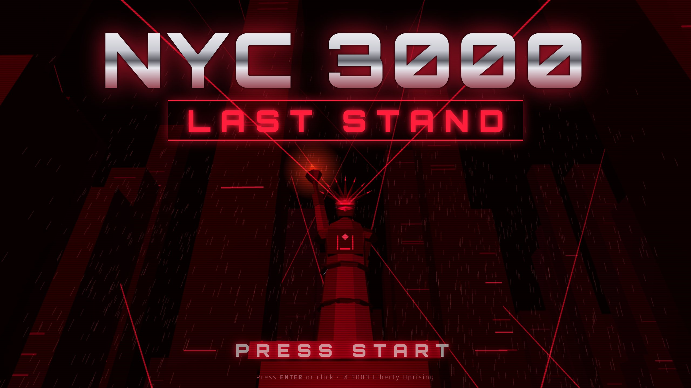
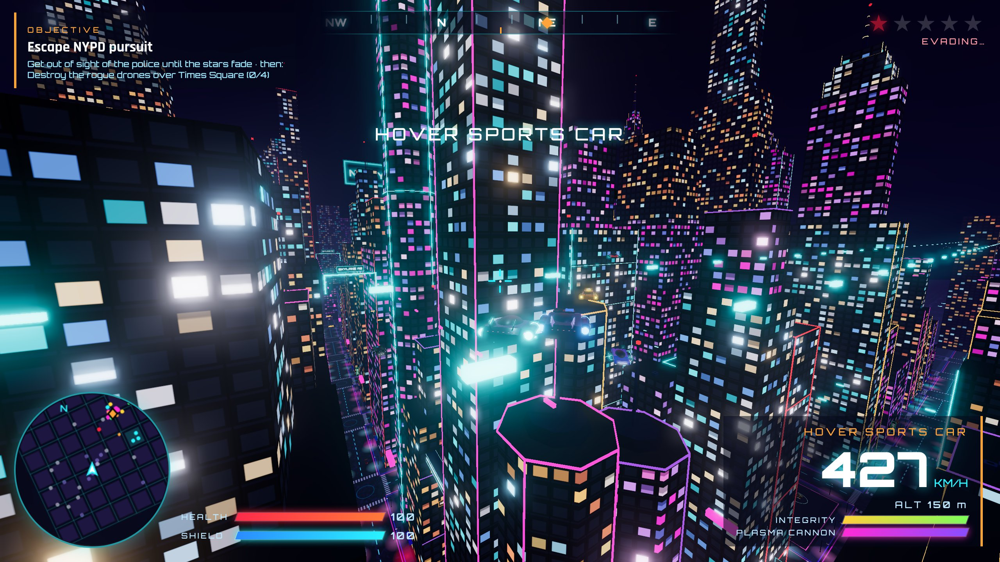

# NYC 3000: Last Stand

A neon open-world shooter set in New York City in the year 3000. It runs in a desktop browser with nothing to install. Fight rogue drones in Times Square, jack cars, fly hover cars through the sky lanes, and get away from the NYPD.



| Main menu | On foot |
|---|---|
|  |  |
| **Driving a stolen car** | **Flying a hover car** |
|  |  |
| **People and cars** | **The skyline** |
|  |  |

## Run it

You need [Node.js](https://nodejs.org) 18 or newer.

```bash
cd nyc3000
npm install
npm run dev
```

Then open the address it prints (http://localhost:5173).

**Static build** (any web host or folder works, because all paths are relative):

```bash
npm run build      # writes dist/
npm run preview    # serves dist/ on http://localhost:4173
```

Upload the `dist/` folder anywhere (GitHub Pages, Netlify, itch.io) to share it.

## How to play

1. The title screen opens first. Press **Enter** or click **PRESS START**.
2. In the main menu, pick **NEW GAME**. **CONTINUE** loads your save; it's greyed out until you have one.
3. Click in the game window to grab the mouse (pointer lock). Press **Esc** to pause.

### Controls

| On foot | |
|---|---|
| W A S D | move |
| Mouse | look and aim |
| Left click | shoot |
| Right click (hold) | zoom aim |
| Shift | sprint |
| Space | jump |
| R | reload |
| 1 / 2 / 3 or mouse wheel | plasma rifle / pulse pistol / scatter cannon |
| F | jack the nearest car (the driver gets thrown out and runs away) |

| In a car | |
|---|---|
| W / S | gas / brake and reverse |
| A / D | steer |
| Space | handbrake (ground cars) |
| Space / Shift | fly up / down (flying cars) |
| Left click | plasma cannon (hover cars) |
| Mouse | look around (the camera swings back by itself) |
| F | get out (flying cars land by themselves first) |

**Esc** pauses (Resume, Options, Save, Controls, Quit to menu). **M** mutes the sound.

### Missions

1. Destroy the rogue drones over Times Square.
2. Steal a car: walk up to one and press **F**.
3. Steal a flying car at **Hover Pad 06** (the orange light beam).
4. Fly through the **SKYLANE A5** gate.
5. Then free roam with drone waves that keep getting bigger.

### Wanted level

You get wanted stars for stealing cars, shooting people, and fighting the police. Police cars chase you, cyber-cops jump out and shoot, and at 2+ stars flying police cruisers join in (at 3+ police drones too). Stay out of sight of the police and the stars fade one by one ("EVADING…"). If you die, you respawn at Liberty Med Center with your stars cleared.

Health: your **shield** soaks up most damage and recharges a few seconds after you stop getting hit. Orange crates are ammo, green crates are health.

## Options

All graphics settings change live, even from the pause menu, and they're saved in the browser.

| Setting | What it does |
|---|---|
| Quality preset | **Low** (for weak laptops), **Medium**, **High**. Changing anything below switches to Custom. |
| Resolution scale | Renders at 40–100% of the screen's pixels. This is the biggest speed boost. |
| Shadows | On or off. |
| Neon glow (bloom) | The glow around neon lights. Turn it off for more speed. |
| View distance | 250–1200 m. Fog and distance culling follow it. |
| Rain | Off, light, medium or storm. |
| Traffic & crowds | How many cars and people. |
| Frame rate cap | VSync, 60 or 30 FPS. |
| Show FPS counter | Top right. |
| Mouse sensitivity, Invert Y, Volume | Controls and sound. |

**Low** uses 60% resolution with no shadows, no bloom, 380 m view, light rain and fewer cars and people. The game picks Low by itself on machines with 4 or fewer CPU cores or 4 GB or less of memory.

## Using your own concept art for the title and menu

The title screen (a dark armored Statue of Liberty with red laser eyes) and the rooftop main menu are drawn live in 3D. To use painted backgrounds instead, put the images in `public/` with these names:

- `public/title-bg.jpg`: the title screen. The HTML title text then hides, and the clickable, blinking **PRESS START** stays on top.
- `public/menu-bg.jpg`: the main menu. The buttons stay on top.

Rebuild or reload, and the game uses them automatically.

## How it's made

- [three.js](https://threejs.org) and [Vite](https://vitejs.dev). Every model, texture and sound is generated in code: low-poly boxes, canvas-drawn neon signs and windows, and Web Audio synths. There are no downloaded art or sound files. The fonts (Orbitron, Rajdhani) are SIL Open Font License, bundled through Fontsource.
- `src/city.js`: a 10×10-block Manhattan grid built from a fixed seed, so saves always load into the same city. Buildings are merged into 2×2-block chunks to keep draw calls low, with collision boxes in a spatial hash.
- `src/game.js`: player, weapons, plasma bolts, pedestrians, traffic on a road graph, sky-lane flying traffic, police AI, missions, save data.
- `src/people.js`: people. Each one is a single skinned mesh with a 17-bone skeleton: knees, elbows and hands, a walk and run cycle, and two-bone arm IK so the hands really grip the gun. There are 14 pedestrian looks (hair, hoods, caps, coats, neon trims, visors, glowing umbrellas), plus the armored soldier and the NYPD cyber-cop.
- `src/cars.js`: cars. Bodies are extruded from side profiles with bevelled edges and wheel arches, with glass cabins, rims with neon rings, light bars, and NYPD and TAXI markings. Hover cars have a canopy, thruster pods, fins and hover pads.
- `src/city.js` buildings: glass towers, octagonal towers, stepped art-deco crowns with spires, and brick walk-ups with fire escapes and wooden water towers. Streets have lit shop fronts with awnings and neon sign strips, and tall roofs get helipads, antennas and glowing skybridges.
- `src/models.js`: guns, drones, pickups. `src/parts.js`: the shared part builder and a material where neon parts glow in the same draw call as the body.
- `src/title.js`: the title-screen statue scene. `src/hud.js`: HUD, minimap and compass. `src/settings.js`: options and presets.
- Anti-glitch measures:
  - signs and billboards float 0.35–0.75 m off walls, and floor glow decals use polygon offset, so there's no z-fighting;
  - the shadow camera snaps to shadow-map texels, so shadows don't shimmer;
  - the ground is a hard floor at y = 0 for everything;
  - the camera is pushed out of walls and lamp posts.
- `window.nyc` is a debug handle. For example, `nyc.sim(5)` advances the game 5 seconds without rendering, which is handy for automated tests.
