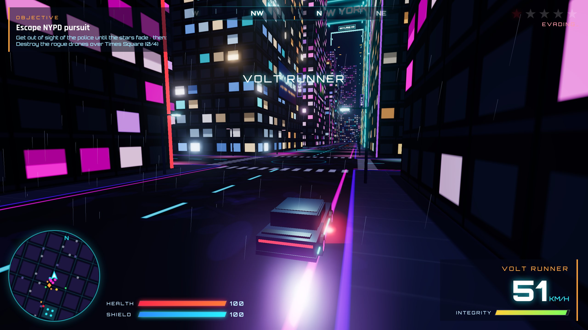
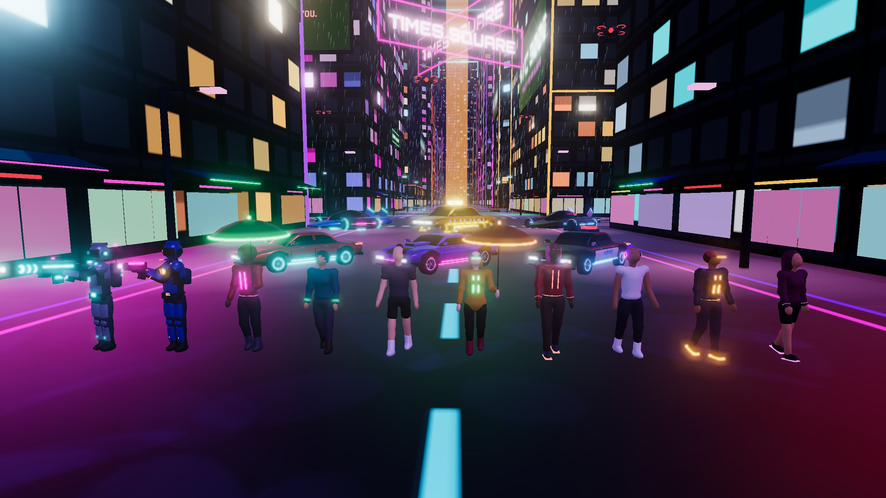
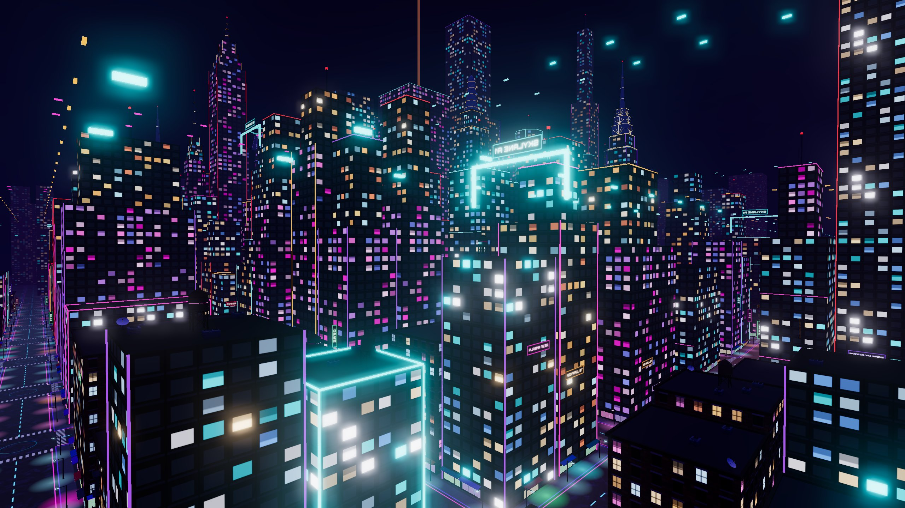
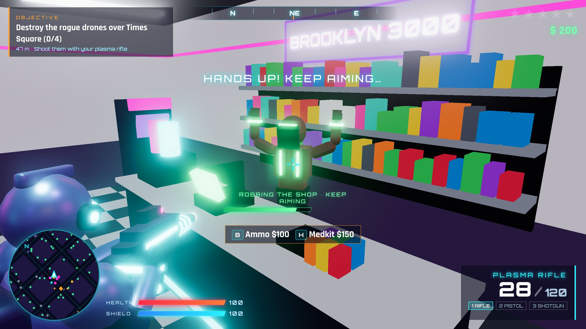
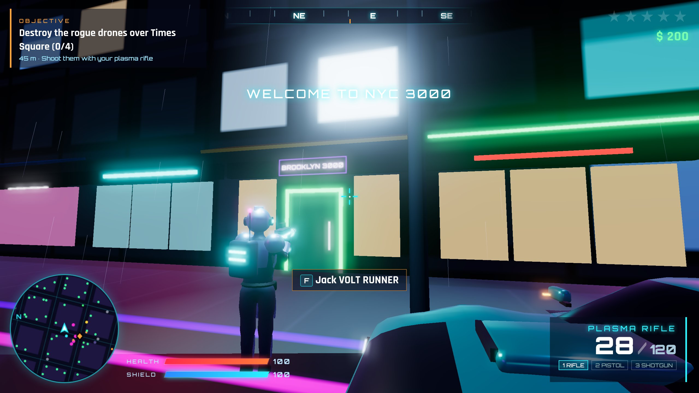

# NYC 3000: Last Stand

A neon open-world shooter set in New York City in the year 3000. It runs in a desktop browser with nothing to install. Fight rogue drones in Times Square, jack cars, fly hover cars through the sky lanes, and get away from the NYPD.

The people, cars, landmark skyscrapers and rooftop props are modelled in [Blender](https://www.blender.org) by Python scripts in [`blender/`](blender/), so every model can be rebuilt from code.


| Main menu | On foot |
|---|---|
|  |  |
| **Driving a stolen car** | **Flying a hover car** |
|  |  |
| **People and cars (Blender models)** | **The skyline with the Blender towers** |
|  |  |
| **Robbing a shop** | **Inside a flat** |
|  |  |

## Run it

You need [Node.js](https://nodejs.org) 18 or newer.

```bash
cd nyc3000
npm install
npm run dev
```

Then open the address it prints (http://localhost:5173).

**Static build** (any web host or folder works, because all paths are relative):

```bash
npm run build      # writes dist/
npm run preview    # serves dist/ on http://localhost:4173
```

Upload the `dist/` folder anywhere (GitHub Pages, Netlify, itch.io) to share it.

## How to play

1. The title screen opens first. Press **Enter** or click **PRESS START**.
2. In the main menu, pick **NEW GAME**. **CONTINUE** loads your save; it's greyed out until you have one.
3. Click in the game window to grab the mouse (pointer lock). Press **Esc** to pause.

### Controls

| On foot | |
|---|---|
| W A S D | move |
| Mouse | look and aim |
| Left click | shoot |
| Right click (hold) | zoom aim |
| Shift | sprint |
| Space | jump |
| R | reload |
| 1 / 2 / 3 or mouse wheel | plasma rifle / pulse pistol / scatter cannon |
| F | jack the nearest car (the driver gets thrown out and runs away) |
| E | go into a shop or a flat, leave it, or sleep in a flat's bed |
| Right click (hold) on a shop clerk | rob the shop |
| B / H | buy ammo / a medkit at a shop counter |

| In a car | |
|---|---|
| W / S | gas / brake and reverse |
| A / D | steer |
| Space | handbrake (ground cars) |
| Space / Shift | fly up / down (flying cars) |
| Left click | plasma cannon (hover cars) |
| Mouse | look around (the camera swings back by itself) |
| F | get out (flying cars land by themselves first) |

**Esc** pauses (Resume, Options, Save, Controls, Quit to menu). **M** mutes the sound.

### Missions

1. Destroy the rogue drones over Times Square.
2. Steal a car: walk up to one and press **F**.
3. Steal a flying car at **Hover Pad 06** (the orange light beam).
4. Fly through the **SKYLANE A5** gate.
5. Then free roam with drone waves that keep getting bigger.

### Shops, flats and money



Every building has 5 street doors: 2 shops and 3 flats (brick walk-ups have 1 shop and 4 flats, Times Square buildings 3 shops and 2 flats). Shop doors glow green with the shop's name above them, and shops show as green dots on the minimap. Flat doors are metal with a warm light, a lamp and an intercom. Walk up to a door and press **E** to go in.

- **Shops:** hold **right click** to aim your gun at the clerk. They put their hands up, and if you keep aiming the robbery bar fills, then they drop a bag of money ($150–$500) on the counter. Walk up to the counter to grab it. The alarm goes off and you get 2 wanted stars, and that shop has nothing left for 4 minutes. You can also pay at the counter: **B** for ammo ($100), **H** for a medkit ($150).
- **Flats:** each flat has a TV, a kitchen, a sofa and a bed. Most flats hide one stash (cash, ammo or a medkit) that you can find once. Press **E** at the bed to sleep: it heals you, clears your wanted level and saves the game.
- Your money is shown in the top right. You start with $200, and it's kept in your save.

### Wanted level

You get wanted stars for stealing cars, shooting people, and fighting the police. Police cars chase you, cyber-cops jump out and shoot, and at 2+ stars flying police cruisers join in (at 3+ police drones too). Stay out of sight of the police and the stars fade one by one ("EVADING…"). If you die, you respawn at Liberty Med Center with your stars cleared.

Health: your **shield** soaks up most damage and recharges a few seconds after you stop getting hit. Orange crates are ammo, green crates are health.

## Options

All graphics settings change live, even from the pause menu, and they're saved in the browser.

| Setting | What it does |
|---|---|
| Quality preset | **Low** (for weak laptops), **Medium**, **High**. Changing anything below switches to Custom. |
| Resolution scale | Renders at 40–100% of the screen's pixels. This is the biggest speed boost. |
| Shadows | On or off. |
| Neon glow (bloom) | The glow around neon lights. Turn it off for more speed. |
| View distance | 250–1200 m. Fog and distance culling follow it. |
| Rain | Off, light, medium or storm. |
| Traffic & crowds | How many cars and people. |
| Frame rate cap | VSync, 60 or 30 FPS. |
| Show FPS counter | Top right. |
| Mouse sensitivity, Invert Y, Volume | Controls and sound. |

**Low** uses 60% resolution with no shadows, no bloom, 380 m view, light rain and fewer cars and people. The game picks Low by itself on machines with 4 or fewer CPU cores or 4 GB or less of memory.

## Using your own concept art for the title and menu

The title screen (a dark armored Statue of Liberty with red laser eyes) and the rooftop main menu are drawn live in 3D. To use painted backgrounds instead, put the images in `public/` with these names:

- `public/title-bg.jpg`: the title screen. The HTML title text then hides, and the clickable, blinking **PRESS START** stays on top.
- `public/menu-bg.jpg`: the main menu. The buttons stay on top.

Rebuild or reload, and the game uses them automatically.

## The Blender models

`blender/` holds the Python scripts that model everything in Blender, and `public/models/` holds what they export (`cars.glb`, `people.glb`, `buildings.glb`). The exported files are committed, so the game runs without Blender. To change a model, edit its script and rebuild ([Blender](https://www.blender.org/download/) 4.2 or newer; tested with 4.5 LTS):

```bash
cd nyc3000
blender -b --factory-startup -P blender/build.py -- all
```

`npm run models` does the same if `blender` is on your PATH. Build one group with `-- cars`, `-- people`, `-- buildings` or `-- interiors`. Add `--preview some/folder` to also render Cycles preview images of the models. If `blender` isn't on your PATH, use its full path, for example `/Applications/Blender.app/Contents/MacOS/Blender` on a Mac.

- `blender/cars.py`: six vehicles. Ground cars have lofted bodies: smooth cross-sections along a side profile with real wheel arches, a greenhouse split into glass, roof and pillars, door seams, lathed tyres and rims with neon rings, headlights, a full-width tail light, mirrors and underglow. The muscle car has a hood scoop, racing stripes, a spoiler and quad exhausts. The police car has white doors, a light bar and a push bar. Hover cars have a bubble canopy, thruster pods on pylons, tail fins and glowing hover pads. The sky taxi has a checker stripe, a roof sign and four hover pods.
- `blender/people.py`: the soldier, the NYPD cyber-cop and 12 pedestrians. Bodies are metaballs, one smooth piece per item of clothing (top, trousers or skirt, skin, shoes, hair, hood), plus hard-surface armour, helmets with visors, caps, headphones, bags and neon umbrellas. They're skinned to the game's 17-bone skeleton in an A-pose, so the walk and run cycle and the gun-holding arm IK still drive them.
- `blender/buildings.py`: six landmark skyscrapers (an art-deco spire with a sunburst crown, a twisting glass tower, a round tower with a floating halo ring, a stepped Empire-style tower with a mast, a glass-pyramid tower and a slim tower with a sloped crown) and rooftop props (wooden water towers, one kind with neon, AC units and satellite dishes). Tower facades are UV-mapped for the game's window textures, and their collision boxes are exported too.
- `blender/interiors.py`: the inside of a neon corner shop (checkered floor, aisles full of products, a counter with a cash register, drink fridges, an arcade machine, an ATM) and a flat (wooden floor, kitchen with an island, sofa, TV, gaming desk, bed, big window). The lighting is baked into the vertex colours with ray-traced shadows, so the game draws the rooms cheaply.
- `blender/lib.py`: shared helpers: part building, lofts and lathes, ambient occlusion baked into vertex colours with ray casts, sharp edges by angle, GLB export and preview renders.
- Every car and person also gets a lighter far-away version (level of detail), so the game stays as fast as before.

## How it's made

- [three.js](https://threejs.org), [Vite](https://vitejs.dev) and [Blender](https://www.blender.org). Every model, texture and sound is generated by code: models by the Blender scripts above, canvas-drawn neon signs and windows, and Web Audio synths. There are no downloaded art or sound files. The fonts (Orbitron, Rajdhani) are SIL Open Font License, bundled through Fontsource.
- `src/interiors.js`: builds the shop and flat rooms far outside the city. Going through a street door moves you into the right room, and the police wait outside the door.
- `src/assets.js`: loads the Blender GLB files at start-up and flattens each model into one or two meshes with vertex colours, a neon glow flag and per-vertex shininess. If a file is missing, the game falls back to its built-in code models.
- `src/city.js`: a 10×10-block Manhattan grid built from a fixed seed, so saves always load into the same city. Buildings are merged into 2×2-block chunks to keep draw calls low, with collision boxes in a spatial hash. Every building gets 5 street doors (shops and flats). The Blender towers stand on podiums with shop fronts, among code-built glass towers, octagonal towers, art-deco crowns, brick walk-ups with fire escapes, helipads and glowing skybridges.
- `src/game.js`: player, weapons, plasma bolts, pedestrians, traffic on a road graph, sky-lane flying traffic, police AI, missions, save data.
- `src/people.js`: the 17-bone skeleton (knees, elbows, hands), the walk and run cycle and the two-bone arm IK that puts the hands on the gun. It also has the code-built fallback people.
- `src/cars.js`: vehicle stats, sirens, NYPD and TAXI decals, and the code-built fallback cars.
- `src/models.js`: guns, drones, pickups. `src/parts.js`: the shared part builder and a material where neon parts glow in the same draw call as the body.
- `src/title.js`: the title-screen statue scene. `src/hud.js`: HUD, minimap and compass. `src/settings.js`: options and presets.
- Anti-glitch measures:
  - signs and billboards float 0.35–0.75 m off walls, and floor glow decals use polygon offset, so there's no z-fighting;
  - the shadow camera snaps to shadow-map texels, so shadows don't shimmer;
  - the ground is a hard floor at y = 0 for everything;
  - the camera is pushed out of walls and lamp posts.
- `window.nyc` is a debug handle. For example, `nyc.sim(5)` advances the game 5 seconds without rendering, which is handy for automated tests.
