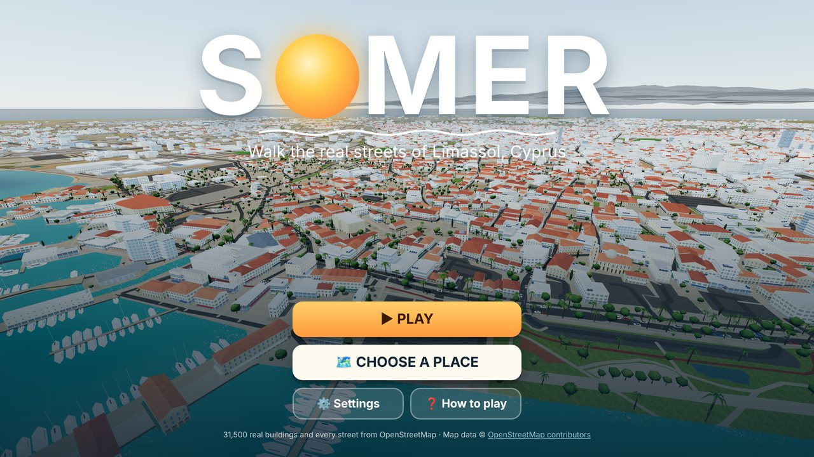
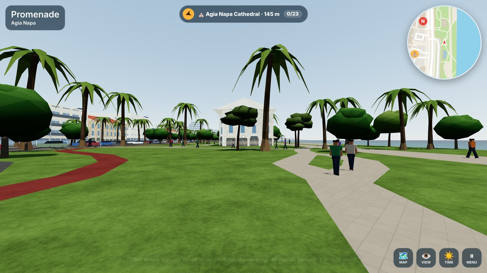
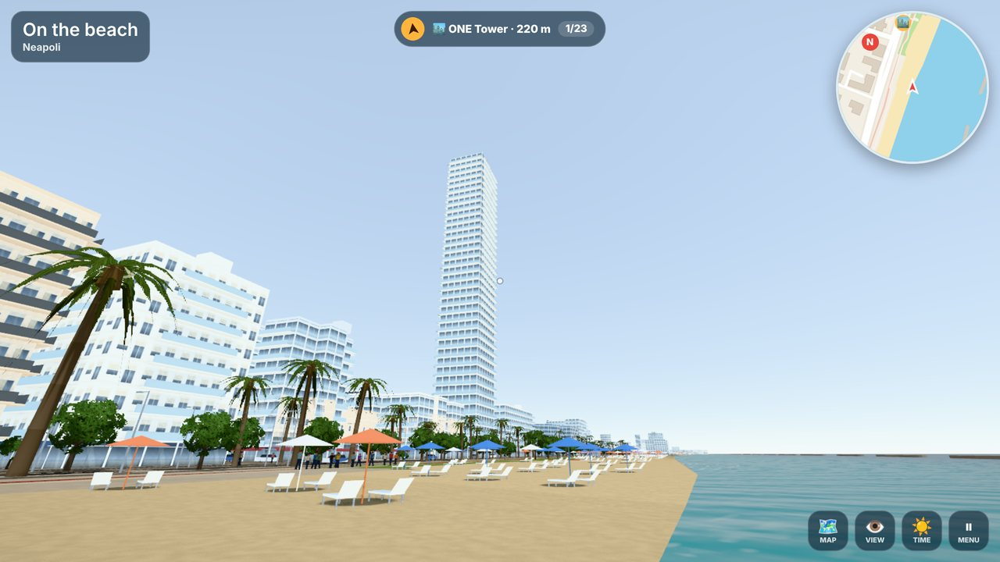
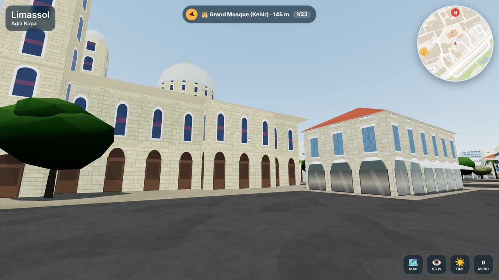
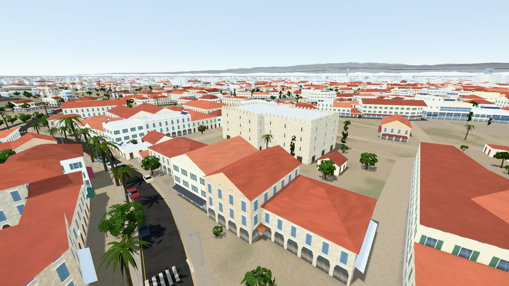
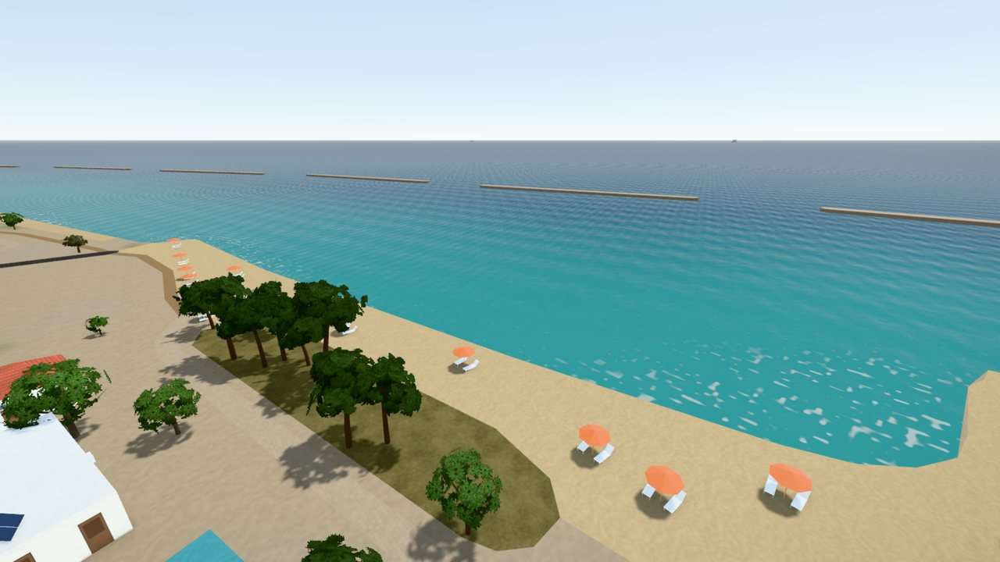
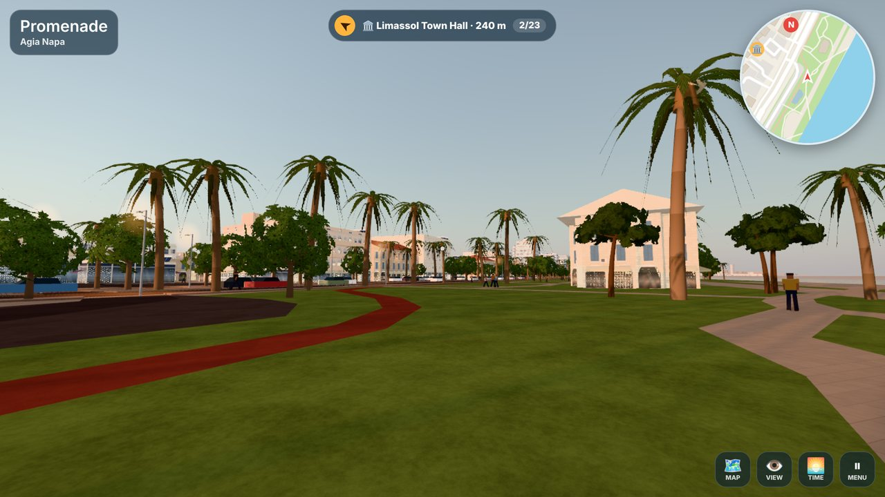
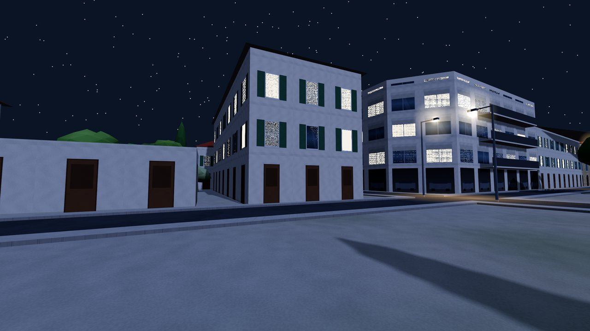
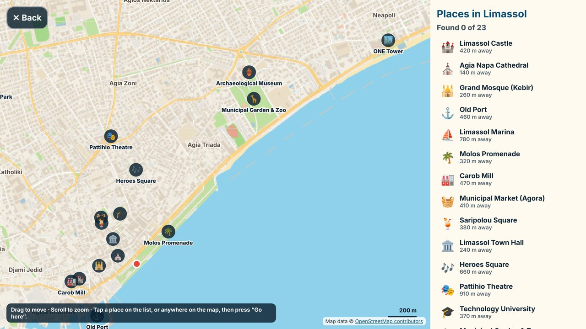

# SUMER — Walk Limassol

A walking game in a 3D copy of **Limassol, Cyprus**, made from the real map. It is a separate game from Amboola (no cars to race); you just walk, run, swim and explore.

**Play:** open `sumer/index.html` from a web server (for example `npx http-server -p 8080 .` in the repo, then <http://localhost:8080/sumer/>), or on GitHub Pages at `…/Amboola/sumer/` once this folder is on the Pages branch.



| | |
|---|---|
|  |  |
| **The Molos** promenade: palms, lawns, paths and people walking | **The ONE tower** (170 m) behind the beach umbrellas |
|  |  |
| **Agia Napa Cathedral** with its dome and bell towers | **The old town** with its red tile roofs, from the drone (the castle is the big stone block in the middle) |
|  |  |
| **Dasoudi beach**, the pine park and the rock breakwaters | **Sunset** on the Molos |
|  |  |
| **Night**: lit windows, street lamps and stars | **The map**: pick a place and walk there |

## What is in the city

- **31,545 buildings** in their real places and real shapes, from OpenStreetMap. Towers with a mapped height (the ONE tower at 170 m, the Trilogy towers and others) have their real height. For most other buildings the height, colour and roof are estimated from the building type, its size, and how close it is to the old town or the sea.
- **Every street and path** (about 30,000 pieces): asphalt with markings, zebra crossings, raised sidewalks with kerbs, footpaths, cycle paths, the Molos promenade, piers and the rock breakwaters in the sea.
- **Parks, beaches, pitches, pools, parking lots** and the coastline of the whole island.
- **107,000 trees** from the map (single trees, tree rows, parks, pine woods, orchards) plus garden trees placed in the yards next to houses, as in the satellite view: palms on the seafront, Aleppo pines, ficus street trees, cypresses, olives and lemon trees.
- **Cars** in five kinds seen all over Limassol (small hatchbacks, saloons, SUVs, double-cab pickups and vans): rounded bodies with glossy clear-coat paint that reflects the sky, dark glass, alloy wheels, mirrors, Cyprus plates (white in front, yellow at the back), and lights that come on at dusk on the cars that drive (on the left, as in Cyprus).
- Limassol details seen in photos and Street View: red tile roofs in the old town, white and cream apartment blocks with long balconies, **solar water heaters on every flat roof**, wooden shutters, limestone walls, shop awnings, parked cars, street lamps, beach umbrellas, yachts in the marina, ships waiting off the coast and the hills of Troodos behind the city.
- Landmarks with their own shapes: **Limassol Castle** (battlements), **Agia Napa Cathedral** (dome and bell towers), the **Grand Mosque** (minaret), and the other churches with domes and bell towers.

## The game

- Find **23 famous places** (castle, cathedral, Old Port, Marina, Molos, Agora, ONE tower, Dasoudi beach, ancient Amathus, and more). The orange arrow at the top points to the nearest one you have not found yet. Your progress is saved in the browser.
- The panel at the top left shows the **real street name** and district where you are.
- **Map (M):** the whole city; pick any place or spot and press *Go here*.
- **Time (T):** morning, midday, sunset, night (lit windows, street lamps, stars).
- **Swim** in the sea, walk on the piers, climb onto the breakwaters.
- **Drone (F):** fly over the city.
- Sounds are made in the browser: footsteps that change on sand, grass, wood and stone, waves near the sea, cicadas in the trees by day, crickets at night, seagulls.

| Action | Keyboard / mouse | Phone / tablet | Gamepad |
|---|---|---|---|
| Look | click the game, move the mouse | drag on the right side | right stick |
| Walk | W A S D or arrows | round stick | left stick |
| Run | hold Shift | 🏃 | B |
| Jump | Space | ⤒ | A |
| Map | M | 🗺️ | X |
| View (eyes / behind) | C | 👁️ | Y |
| Drone | F (E up, Q down) | | |
| Time of day | T | 🌅 | Back |
| Menu | Esc | ⏸ | Start |

Graphics: Low, Medium, High or Ultra in Settings (phones start on Low). From Medium up the game draws soft contact shadows (ambient occlusion) in corners, under balconies and where walls meet the street, leafy trees with leaf-shaped shadows (olive, ficus, carob, Aleppo pine, cypress, lemon and palm fronds), softer, brighter light and antialiased edges.

## How it is made

- `index.html`: the page, menus and HUD.
- `js/data.js`: reads `data/limassol.bin.gz`, a compact binary file of the city split into 250 m chunks.
- `js/city.js`: turns the map into 3D in 1 km blocks around you (ground, roads, sidewalks, buildings, roofs, domes, towers) and adds the close-up details (balconies, roof heaters, cars, lamps, boats, umbrellas) in 250 m pieces near you.
- `js/textures.js`: paints the building fronts and ground textures at load time (no image downloads).
- `js/env.js`: sky, sun, sea, the far coast and hills. `js/trees.js` + `js/forest.js`: the trees. `js/player.js`: walking, collisions, swimming, cameras. `js/ui.js`: minimap and big map. `js/audio.js`: sound.
- Three.js 0.169 and earcut 3.0.1 come from jsDelivr.

### Rebuilding the city data

The data comes from an OpenStreetMap extract of Cyprus (`cyprus.pbf`, about 43 MB, for example from geo2day.com or Geofabrik). With Python 3 and `pip install osmium shapely numpy`:

```bash
cd sumer/tools
python3 extract.py cyprus.pbf raw.pkl
python3 build_data.py raw.pkl built.pkl
python3 pack.py built.pkl ../data/limassol.bin.gz landmarks.json
```

`landmarks.json` holds the 23 places of the game (name, position in metres from the origin near the castle, radius, emoji, text).

## Credits

Map data © [OpenStreetMap contributors](https://www.openstreetmap.org/copyright), available under the Open Database License (ODbL). The game shows this credit on the title screen and the map.
